# SILAS VANE: El Misterio de la Mansión — Game Design Document

| | |
|---|---|
| **Autor** | Donoban Ramón (DonobanR). Trabajo individual: diseño, programación, narrativa, integración de arte y pruebas |
| **Documento** | Examen individual: Game Design Document (GDD) |
| **Versión del juego** | v2, investigación libre en 2.5D (rama `v2-investigacion`) |
| **Motor** | Phaser 3.80.1 con módulos ES, ejecutado directo en el navegador |
| **Publicado** | itch.io (HTML5) · página de presentación: [DonobanR/LandingPage-SilasVane](https://github.com/DonobanR/LandingPage-SilasVane) |
| **Fecha** | noviembre de 2026 |

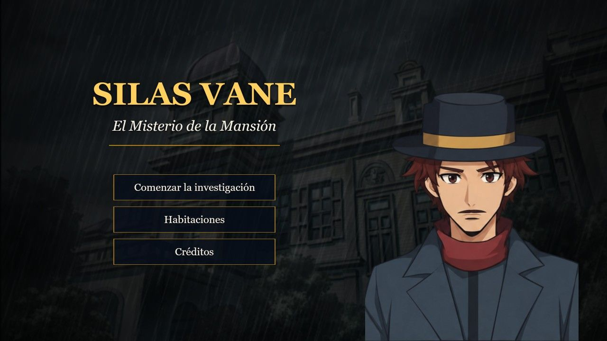

**Contenido:** [01 High Concept](#01-high-concept) · [02 Pilares MDA](#02-pilares-mda) · [03 Core Loop y mecánicas](#03-core-loop-y-mecánicas) ·
[04 Mundo y actores](#04-mundo-y-actores) · [05 Niveles](#05-niveles) · [06 Arte, audio y UI](#06-arte-audio-y-ui) · [07 Alcance MVP](#07-alcance-mvp)

Los datos de este documento salen del juego: los textos de `assets/narrativa/`, las reglas de `assets/investigaciones/`, los mapas de
`assets/mapas/` y el diseño de `DISENO_V2.md`. Las citas entre comillas son líneas del juego.

---

## 01. High Concept

### Ficha técnica

| Campo | Valor |
|---|---|
| **Género** | Aventura de investigación y misterio, con presentación de novela visual |
| **Perspectiva** | 2.5D cenital 3/4: suelo visto desde arriba, paredes y muebles con frente y altura |
| **Plataforma** | Navegador (HTML5). PC con teclado y ratón; celular en horizontal con controles táctiles |
| **Modo** | Un jugador, campaña de 6 habitaciones |
| **Público objetivo** | Adolescentes y adultos (12+) que disfrutan de los misterios, las historias de detectives y las novelas visuales. La tensión nace de la oscuridad y del descubrimiento |
| **Estilo visual** | Mansión a oscuras iluminada por la linterna; azul noche y dorado; retratos de anime del inspector |
| **Idioma** | Español |
| **Lienzo** | 1280 × 720 (16:9), escalado `FIT` |

### Elevator Pitch

> Investigación en 2.5D con linterna: el inspector Silas Vane recorre una mansión «embrujada» bajo la tormenta.
> Las marcas, los hilos y las huellas aparecen cuando la luz los alcanza.
> En cada habitación desmonta un fenómeno y lo demuestra con pruebas en su libreta, hasta dar con quien está detrás.

### El gancho

- Silas investiga con su linterna: el cono se recorta contra paredes y muebles, y las pistas ocultas aparecen al entrar en la luz.
- Cada conclusión se demuestra con las pruebas que el jugador elige; vale cualquier combinación que reúna los hechos necesarios.
- Cada habitación tiene su propia forma de investigar: seguir la corriente, desarmar un aparato, tirar de hilos, perseguir una sombra.

---

## 02. Pilares MDA

| Pilar | Mecánica (M) | Dinámica (D) | Estética (A) |
|---|---|---|---|
| **1. La luz revela** | Cono de luz con caída y sombras; objetos `revelable` que aparecen bajo la luz; polvo que flota en el haz | El jugador barre la habitación con la linterna, se fija en lo que cambia y sigue rastros (el polvo deriva hacia la corriente, el camino limpio entre el polvo) | **Descubrimiento** y tensión: la oscuridad guarda el secreto y la luz lo entrega |
| **2. Demostrar con pruebas** | Deducción en dos pasos (conclusión entre 3 opciones + hasta 2 o 3 pruebas), evaluada por los hechos que aportan las pruebas | El jugador piensa qué dice cada prueba y arma su propio argumento; Silas le avisa cuando le falta una pieza | **Desafío intelectual** y la satisfacción de «¡ahí está!» |
| **3. Investigar a tu ritmo** | Orden libre; la libreta reúne lo encontrado; la habitación orienta con señales del propio ambiente | Cada jugador elige su camino; las revelaciones surgen de sus propias acciones | **Fantasía** de ser un inspector dentro de la mansión |

**Emoción objetivo:** curiosidad en la oscuridad que se convierte en certeza. El jugador siente que el misterio se resolvió por su
razonamiento.

**Reglas de diseño**

1. Todo fenómeno tiene una explicación física que se puede demostrar con pruebas.
2. Cada mecánica sirve para investigar o para contar la historia.
3. Equivocarse es parte de la investigación: *«Corregir un error también es parte del método.»*
4. La historia se cuenta con la voz de Silas Vane, desde lo que él observa y deduce.

---

## 03. Core Loop y mecánicas

### Core loop

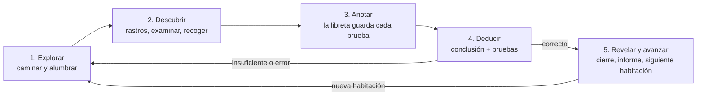

Una habitación, de principio a fin:

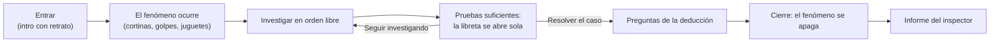

### Tabla de mecánicas

| Mecánica | Input (teclado / celular) | Regla | Feedback |
|---|---|---|---|
| **Caminar** | WASD o flechas / joystick izquierdo | 8 direcciones a 230 px/s, igual en diagonal; colisión con paredes y muebles; orden por profundidad | Animación de caminar; la cámara sigue al inspector |
| **Apuntar la linterna** | Ratón / sigue la dirección del joystick | Con el teclado apunta hacia donde camina. Cono con bordes suaves que paredes y muebles altos recortan | El cono gira; detrás de los muebles queda sombra |
| **Revelar con la luz** | Automático al alumbrar | Marcas, hilos, huellas y caminos aparecen cuando la luz los toca | Aparecen en el haz y sale una tarjeta **RASTRO** mientras se sigue jugando |
| **Usar (E + verbo)** | E / botón E | Tres condiciones: **cerca** (pies a 40 px o menos), **de frente** (linterna a ±60°) y **con luz**. Se ofrece mientras el objeto tenga algo nuevo que mostrar | Aviso flotante «E Examinar», «E Recoger»… sobre el objeto |
| **Examinar** | E | Dispara un comentario o una revelación, y puede volverse prueba | Tarjeta **LIBRETA**, o pausa con retrato si es revelación |
| **Recoger pista** | E | La pista queda en la libreta y en el Registro de la mansión, que se usa en el nivel 6 | Tarjeta con el título de la pista |
| **Acciones propias** | E | Mirar detrás, mirar debajo, rodar, tirar, cortar, ordenar, cerrar, apagar, abrir. Siguen las dependencias físicas: la cuerda lleva al fuelle | El verbo exacto en el aviso; cambio visible en la habitación |
| **Libreta** | Tab o I / botón libreta | Pausa el juego y reúne lo encontrado; con pruebas suficientes ofrece «Resolver el caso» | El ícono late cuando ya se puede resolver; más fuerte tras 45 s |
| **Deducción: conclusión** | Flechas o WASD + E/Enter, o ratón | 3 opciones en orden mezclado: la verdadera, una explicación física equivocada y la versión de la leyenda | La conclusión elegida queda arriba en dorado |
| **Deducción: pruebas** | Igual que arriba | Se marcan **hasta 2** pruebas (3 en el nivel 6); el jugador decide cuántas presentar | Correcta: avanza. Insuficiente o error: línea del inspector y se repite la pregunta |
| **Avanzar texto** | E, Espacio, Enter o clic / E o tocar la pantalla | Los textos importantes pausan el juego; las notas salen mientras se sigue caminando | «E / Espacio / clic para continuar» con flecha |
| **Historial** | H / botón historial | Reúne todos los textos de la habitación, en orden | Panel de historial como en una novela visual |
| **Música** | M / botón MÚSICA | Silencia o vuelve a encender la música | El ícono de la música cambia |
| **Pausa** | Esc / botón PAUSA | «Continuar» o «Salir al menú», con confirmación | Menú de pausa sobre el juego detenido |
| **Ayuda ambiental** | Automática | Cuando el jugador lleva 45 s buscando (15 s en el nivel 5), la habitación señala lo siguiente | Resplandor tenue que respira (ciclo de 2,5 s), cortinas más agitadas, una onda, un hilo que brilla |
| **Captura (nivel 5)** | Linterna + caminar | Mantener a la sombra en el cono a 150 px o menos durante 1,5 s, con la salida al jardín bloqueada | La sombra queda atrapada; cierre «¡Atrapado!» |

### Deducción por hechos

Cada prueba aporta uno o más **hechos** y cada conclusión **necesita** ciertos hechos. Se evalúa la información que aportan las pruebas
en conjunto.

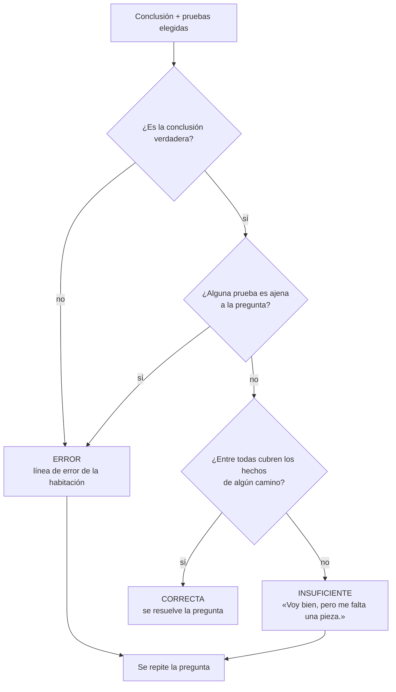

**Ejemplo (nivel 4): «¿Cómo se mueven los juguetes?»** Conclusión verdadera: *Con hilos manejados desde una trampilla del techo.*

| Prueba | Hechos que aporta | Resultado si se presenta sola |
|---|---|---|
| BOBINA DE HILO DE PESCAR | hay hilos · vienen de la trampilla | Correcta |
| Oso con hilo cosido | hay hilos | Insuficiente |
| Trampilla del techo | vienen de la trampilla | Insuficiente (con el oso, correcta) |
| Caballito engrasado | apoya la opción de los engranajes | Error (ajena) |

**Pistas clave:** la deducción se abre al tener el **RECORTE DE PERIÓDICO** (nivel 1), la **CARTA SIN ENVIAR** (nivel 3) y la
**PÁGINA DE UN DIARIO INFANTIL** (nivel 4), y al examinar la **Pluma «G. V.»** (nivel 6), porque el caso final se apoya en ellas. El resto
de los hallazgos son opcionales.

### Condiciones de victoria y derrota

Cada fallo devuelve al jugador a la investigación con todo lo que ya consiguió.

| Situación | Qué pasa |
|---|---|
| **Victoria de una habitación** | Todas las preguntas correctas → cierre (el fenómeno se apaga) → informe → «Siguiente habitación». En el nivel 3 el jugador además **abre** la puerta (llave de latón o ganzúas) y en el nivel 4 **corta** el último hilo |
| **Victoria del nivel 5** | Capturar a la sombra y abrir la puerta al despacho, con la chimenea apagada |
| **Victoria del juego** | Resolver el despacho: se abre el compartimento bajo el reloj, llega el informe «¡CASO CERRADO!» y el botón «Ver créditos» |
| **Derrota: respuesta insuficiente** | *«Voy bien, pero me falta una pieza.»* Se repite la pregunta y el jugador puede salir a buscar más pruebas |
| **Derrota: respuesta errónea** | La línea de error de la habitación (por ejemplo *«No. Desenredemos esto con calma.»*) y se repite la pregunta; las preguntas ya resueltas quedan resueltas |
| **Derrota en el nivel 5** | La sombra escapa por el jardín, si la salida sigue abierta, o los papeles terminan de quemarse a los 60 s, si la chimenea sigue encendida. Silas dice *«Calma. Si me precipito, se escapa.»* y se repite ese tramo; la salida bloqueada y la chimenea apagada se mantienen |
| **Salir desde la pausa** | Se pierde lo investigado en esa habitación (con confirmación); las habitaciones resueltas y las pistas del Registro se conservan |

**Progreso:** se guarda en el navegador (`localStorage`). Resolver una habitación desbloquea la siguiente en el menú de habitaciones.
Al entrar al despacho, el juego repone cualquier pista imprescindible de una habitación ya resuelta, para que el caso final siempre se
pueda cerrar.

---

## 04. Mundo y actores

### Narrativa breve

*«La Mansión Flieder lleva años abandonada. Los lugareños afirman que sombras malditas mueven los objetos por las noches.»* El inspector
Silas Vane llega bajo la tormenta. Su objetivo: entrar habitación por habitación y demostrar con pruebas físicas que la «magia» es una
fachada. Desde la muerte del señor Flieder, el albacea de la familia, Gerhard Voss, administra la mansión hasta que aparezca un comprador.

Cada habitación esconde un truco: la corriente de una ventana rota, un mecanismo de poleas y fuelle, un candado que alguien cruza a diario,
juguetes movidos con hilos. Una silueta en la ventana lleva a la captura de un cómplice que quemaba papeles. En el despacho, las cuentas no
cuadran y hay siete ofertas de compra, siete rechazos. Una pluma grabada «G. V.» coincide con la «V» de las notas. Todo apunta a Gerhard Voss:
espantaba a los compradores para buscar el tesoro que el abuelo escondió *«donde el reloj nunca da la hora»*. Bajo el reloj espera el
escondite, vacío, con unas herramientas al lado.

### Actores por comportamiento

| Actor | Rol | Comportamiento en el juego |
|---|---|---|
| **Silas Vane** | Héroe, controlado por el jugador; la voz del juego | Camina, alumbra, examina y deduce. Comenta lo que encuentra en la caja de texto. Su retrato cambia entre 6 expresiones: neutral, pensativo, sonrisa irónica, sorprendido, serio y satisfecho |
| **La sombra (el cómplice)** | Adversario en tiempo real, nivel 5 | **Ruta:** recorre en círculo los puntos junto a la chimenea a 70 px/s mientras quema papeles. **Huir:** si la alumbran desde menos de 400 px o el inspector se acerca a menos de 170 px, corre a 190 px/s (Silas va a 230) hacia la salida al jardín o, si está bloqueada, al escondite más lejano. **Escondida:** si el inspector se acerca a menos de 110 px, cambia de escondite; tras 5 s tranquila vuelve a su ruta |
| **Gerhard Voss** | Antagonista en la sombra | Se le conoce por sus rastros: el recorte, la «V» del recibo y del abrigo, la pluma «G. V.», las cartas rechazadas |
| **Los fenómenos** | Adversarios ambientales | Cortinas que «caminan», golpes metálicos y velas que se apagan, juguetes que se mueven solos. Repiten su efecto hasta que se resuelve la habitación y, con la ayuda ambiental, delatan su propio origen |

---

## 05. Niveles

### Progresión

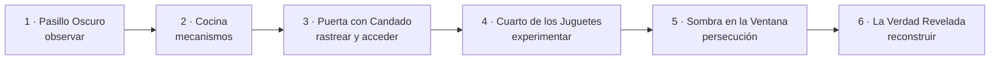

| # | Habitación | Fenómeno | Mecánica propia | Deducción | Para terminar |
|---|---|---|---|---|---|
| 1 | **El Pasillo Oscuro** | Cortinas cuyas sombras parecen caminar | El polvo del haz deriva hacia la corriente; mirar detrás de la pila de cajas | 2 preguntas, hasta 2 pruebas. Pista clave: el recorte | Deducción |
| 2 | **El Fantasma de la Cocina** | Golpes metálicos y velas que se apagan | Cadena física: la onda sale de la alacena → rodarla → cuerda → fuelle; tirar de la cuerda reproduce el «fantasma» | 3 preguntas, hasta 2 pruebas | Deducción |
| 3 | **La Puerta con Candado** | Puerta vieja con candado nuevo | Polvo intacto frente al camino limpio; tablas que crujen; mirar debajo de la caja | 1 pregunta, hasta 2 pruebas. Pista clave: la carta | Abrir la puerta con la llave **o** las ganzúas |
| 4 | **El Cuarto de los Juguetes** | Juguetes que se mueven solos | Hilos que brillan con la luz: tirar de uno y ver qué se mueve; cortar | 1 pregunta, hasta 2 pruebas. Pista clave: el diario | Cortar el último hilo; la silueta cruza la ventana |
| 5 | **La Sombra en la Ventana** | La sombra quema papeles y busca escapar | Persecución en tiempo real: cerrar la salida, apagar la chimenea, acorralar con la luz | La captura es la prueba | Capturar y abrir la puerta al despacho |
| 6 | **La Verdad Revelada** | El reloj del despacho, detenido | Ordenar los archivos; el suelo hueco hace una onda visible; el expediente de toda la mansión | 2 preguntas, hasta 3 pruebas. Pista clave: examinar la pluma | Deducción → compartimento bajo el reloj → créditos |

La curva enseña jugando: el nivel 1 presenta moverse, alumbrar y examinar; el 2 agrega cadenas de causa y efecto; el 3, rastrear y elegir
cómo cruzar; el 4, experimentar; el 5 pone todo bajo presión de tiempo; y el 6 pide cruzar pruebas de toda la mansión.

### Greybox del nivel 1: El Pasillo Oscuro

Dibujado a escala desde `assets/mapas/nivel1.json` (36 × 13 baldosas de 64 px; un pasillo de 34 × 5 baldosas jugables).

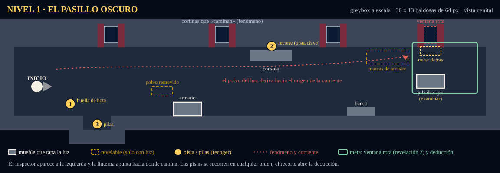

| Elemento | Dónde (en el mapa) | Función |
|---|---|---|
| **Inicio** | Extremo izquierdo | Entra el inspector; sale la intro: *«Primera regla del método: todo deja rastro…»* |
| **Fenómeno** | Las cortinas de las 4 ventanas de la pared norte | Se agitan; las de la ventana rota, casi el doble de fuerte |
| **Obstáculos de luz** | Armario y pila de cajas | Recortan el cono y dejan zonas en sombra que hay que rodear |
| **Revelables** | Polvo removido (centro) y marcas de arrastre (junto a la pila) | Aparecen con la luz; las marcas se pueden examinar |
| **Pistas** | 1 · Huella de bota · 2 · Recorte sobre la consola (pista clave) · 3 · Pilas en la entrada | Pruebas y hallazgo opcional |
| **Meta** | Mirar detrás de la pila → ventana rota (revelación 2) | Da la prueba «Ventana rota»; con el recorte en la libreta se resuelve el caso |

Qué dispara cada revelación (reglas de `assets/investigaciones/nivel1.json`):

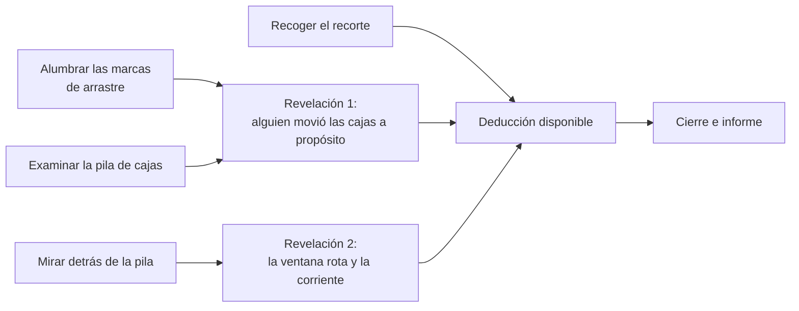

| Pasillo con la linterna | La cocina | La sombra en la ventana |
|---|---|---|
| 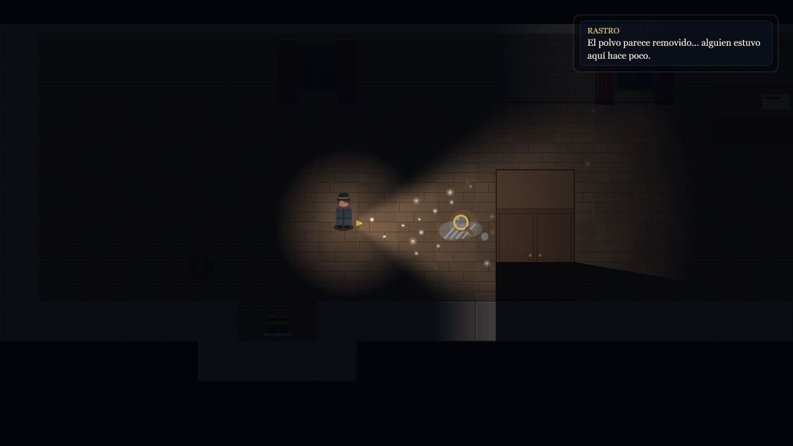 | 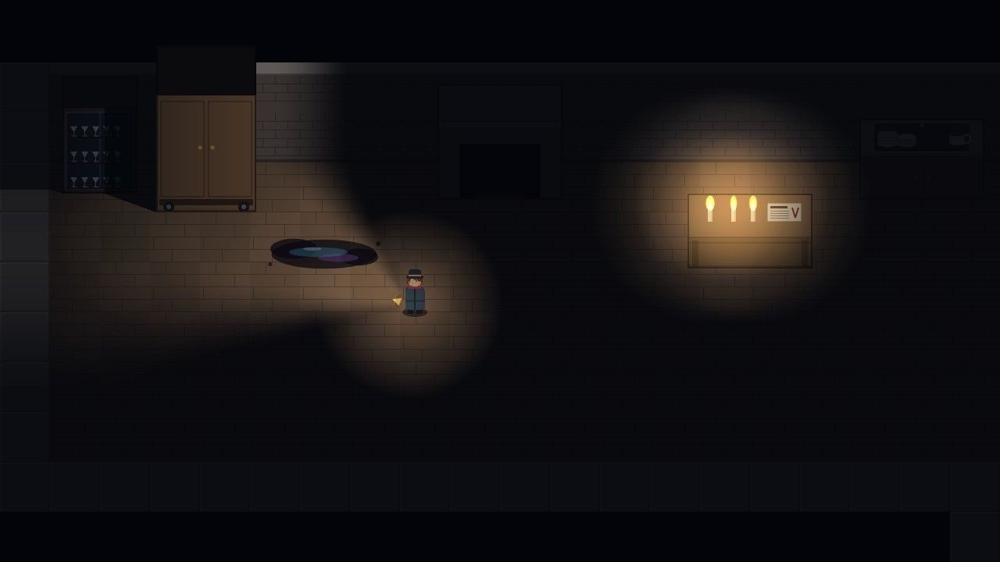 | 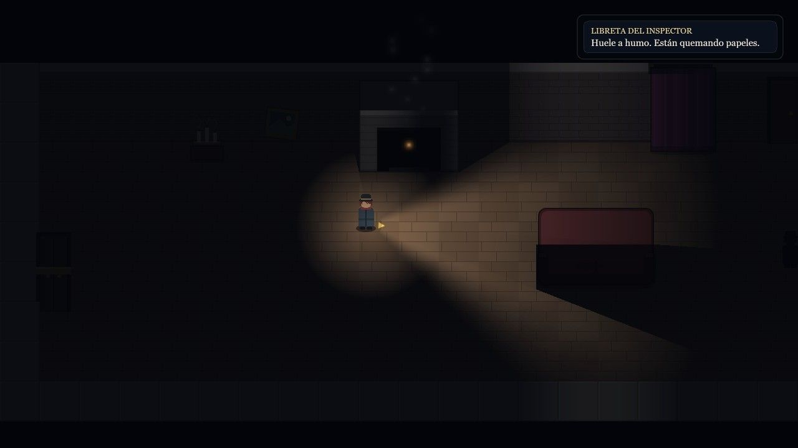 |

---

## 06. Arte, audio y UI

### Dirección de arte

- **Vista cenital 3/4** en un lienzo de 1280 × 720. La habitación vive en la penumbra (oscuridad al 94 %) y la linterna la descubre: un cono
  con bordes suaves, caída de intensidad y un halo alrededor del inspector. Un polígono de visibilidad recorta la luz contra paredes y muebles.
- **Sensación de profundidad:** orden por profundidad, sombras bajo los objetos, luz recortada por los muebles, relámpagos que iluminan la
  sala y polvo que flota en el haz.
- **Arte:** el inspector (en el mapa y en sus 6 retratos de 360 × 480) y la ilustración del cómplice capturado tienen su arte final.
  Habitaciones, muebles y objetos usan arte dibujado por código con el tamaño del arte final; cada dibujo se reemplaza con un PNG del mismo
  nombre.
- **Íconos dibujados** en el mismo estilo de la interfaz: libreta, historial, música y teclas con borde dorado.

### Paleta

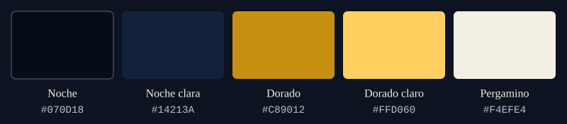

| Color | Hex | Uso en el juego (`src/ui/estilo.js`) |
|---|---|---|
| Noche | `#070D18` | Fondo de cajas de texto, libreta y menús |
| Noche clara | `#14213A` | Botón con el ratón encima |
| Dorado | `#C89012` | Bordes, teclas dibujadas y detalles (la placa del inspector) |
| Dorado claro | `#FFD060` | Títulos, nombres y resaltes |
| Pergamino | `#F4EFE4` | Texto principal |

### Moodboard

| Referencia | Qué aporta a SILAS VANE |
|---|---|
| **Saga *Ace Attorney*** (Capcom) | Presentar pruebas para respaldar una conclusión; retrato expresivo y caja de texto grande |
| ***Darkwood*** (Acid Wizard Studio) | Vista cenital donde la visión se recorta contra las paredes y la oscuridad guarda lo importante |
| ***Scooby-Doo*** (Hanna-Barbera) | La premisa del «fantasma» montado por alguien para alejar a la gente de una propiedad |

Tablero con el resultado en el juego:

| La mansión bajo la tormenta | La voz de Silas |
|---|---|
|  | 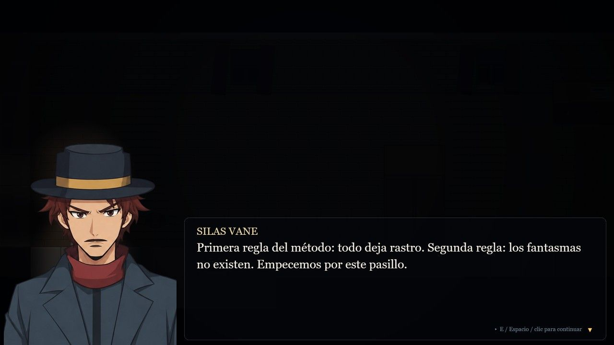 |
| Azul noche, lluvia y título dorado con letra de serifa | Retrato de anime y caja de novela visual, como en *Ace Attorney* |
| **La linterna** | **La libreta** |
|  | 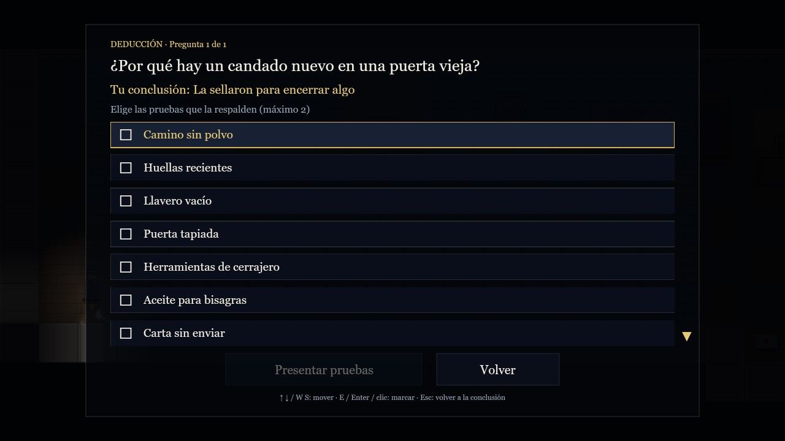 |
| Cono cálido recortado por los muebles, como la visión de *Darkwood* | Pruebas que respaldan una conclusión, como en un juicio |

### Audio

**Música:** cada parte del juego tiene su pista de fondo, con fundido al pasar de una a otra, volumen bajo (0,18) y carga en streaming.
La música empieza con el primer clic o tecla, y **M** la silencia.

| Parte | Archivo | Cuándo suena |
|---|---|---|
| Inicio | `inicio.ogg` | Menú, preámbulo y elección de habitación |
| Habitaciones | `nivel1.ogg` … `nivel6.ogg` | Dentro de cada habitación y en su informe |
| Final | `final.ogg` | Desde el cierre del despacho, el informe final y los créditos |

**Efectos: señales visuales.** La música sostiene el ambiente y cada suceso del juego llega por la vista, para que la investigación se siga
con los ojos, como el propio inspector:

| Suceso | Señal |
|---|---|
| Golpes de la cocina | Un anillo que sale del lado de la alacena |
| Suelo hueco del despacho | Una onda al caminar junto al reloj |
| Tormenta | Relámpagos que iluminan la sala |
| Algo se puede usar | Aviso «E + verbo» que aparece suave y flota |
| Pista recogida | Tarjeta con el título de la pista |
| Revelación | Pausa con retrato y caja grande |
| Error o falta una pieza | La línea del inspector |
| Ya se puede resolver | El ícono de la libreta late |
| Ayuda | Resplandor tenue que respira sobre lo que falta |

### UI/UX: boceto del HUD

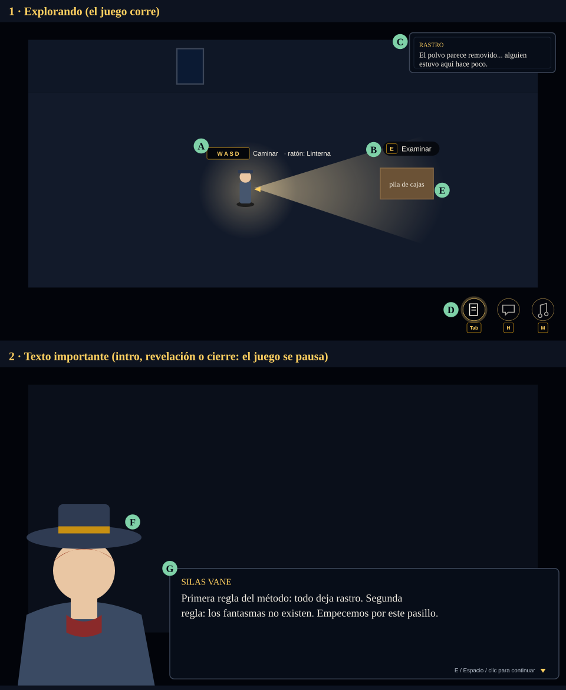

| | Elemento | Comportamiento |
|---|---|---|
| A | Aviso de controles | La primera vez, junto al inspector: «W A S D Caminar» y el ratón para la linterna. Se desvanece al caminar |
| B | Aviso «E + verbo» | Sobre lo que se puede usar: la tecla y lo que hace |
| C | Tarjeta de rastro o de libreta | Arriba a la derecha, mientras se sigue jugando; hasta tres a la vez |
| D | Íconos con su tecla | Libreta (Tab), historial (H) y música (M), abajo a la derecha; también se pulsan con el ratón |
| E | Linterna y objeto | El cono revela; lo que queda tras un mueble sigue en sombra |
| F | Retrato del inspector | En los textos importantes, con la expresión de esa línea |
| G | Caja de novela visual | Nombre, texto y «E / Espacio / clic para continuar» |

**Principios:** la pantalla queda para la habitación y los conteos se reservan para el informe de cada habitación; la libreta reúne lo
encontrado; las pantallas se arman en flujo con zonas desplazables, comprobadas con el revisor (F6) y con el modo `?carga=extrema`.

**En el celular** se juega en horizontal. Mientras se lee un texto, el botón E sirve para continuar:

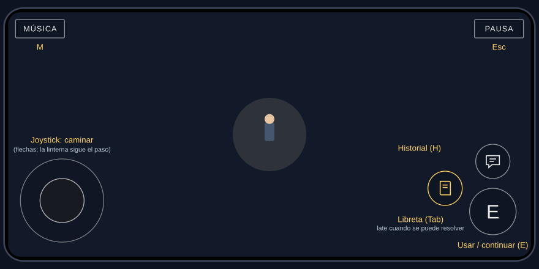

### Flujo de menús

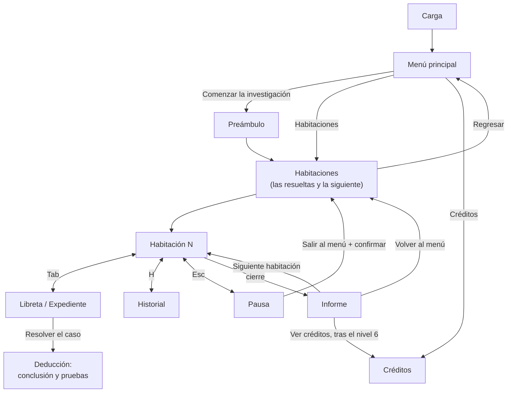

---

## 07. Alcance MVP

### Motor y herramientas

| Herramienta | Uso |
|---|---|
| **Phaser 3.80.1** | Motor 2D: escenas, física Arcade, cámara, dibujo. Se carga desde jsDelivr y el juego corre con módulos ES directo en el navegador |
| **Tiled** | Los 6 mapas en JSON (`assets/mapas/`), con capas de suelo, paredes y objetos (`inicio`, `interactuable`, `revelable`, `bloqueaLuz`, `fenomeno`…). Generadores en Python en `docs/mapas/` |
| **Node.js (`node --test`)** | 37 archivos de pruebas automáticas: lógica del motor, datos de las 6 habitaciones, cada selección posible de cada deducción, el narrador y la maquetación |
| **Python** | `servidor.py`: servidor local con recarga siempre fresca (puerto 8787) |
| **GitHub** | Repositorio, rama `v2-investigacion`, informes por fase en `docs/`; la landing en su propio repositorio |
| **itch.io** | Publicación HTML5 jugable en el navegador |
| **Revisión en el juego** | F3 (FPS), F4 (colisiones), F6 (revisor de maquetación), `?carga=extrema` |

La arquitectura separa datos y lógica: el texto vive en `assets/narrativa/`, las reglas en `assets/investigaciones/` y la lógica en
`src/motor/`, independiente de Phaser, lo que permite probarla con Node.

### Matriz MoSCoW

| Prioridad | Funcionalidad | Estado |
|---|---|---|
| **Must Have** | 6 habitaciones jugables de principio a fin, con su fenómeno y su mecánica propia | Hecho |
| Must Have | Movimiento en 8 direcciones, linterna con luz recortada y revelables | Hecho |
| Must Have | Interacción con «E + verbo» y las tres condiciones (cerca, de frente, con luz) | Hecho |
| Must Have | Libreta, deducción por hechos (correcta, insuficiente, error) y pistas clave | Hecho |
| Must Have | Persecución del nivel 5 con reintento del tramo | Hecho |
| Must Have | Novela visual (retrato, caja de texto), menús, informe y guardado del progreso | Hecho |
| **Should Have** | Controles táctiles para celular | Hecho |
| Should Have | Historial de textos (H) y HUD con íconos y teclas | Hecho |
| Should Have | Música de fondo por habitación, con silencio (M) | Hecho |
| Should Have | Música libre o propia para la versión pública (la actual es de otras obras, para la versión de clase) | Pendiente |
| **Could Have** | Arte final de habitaciones, muebles y objetos | Pendiente |
| Could Have | Mapas de normales para que los objetos reaccionen a la luz | Pendiente |
| Could Have | Récord de tiempo por habitación | Pendiente |
| Could Have | Habitaciones conectadas por puertas | Pendiente |
| **Won't Have** | Efectos de sonido y voces | Fuera de esta entrega |
| Won't Have | Combate y sistema de vidas | Fuera de esta entrega |
| Won't Have | Más personajes con diálogo, escenas o giros de historia | Fuera de esta entrega |
| Won't Have | Guardado a mitad de una habitación y multijugador | Fuera de esta entrega |

### Riesgos y mitigación

| Riesgo | Mitigación |
|---|---|
| Que una deducción tenga una sola respuesta escondida | Evaluación por hechos y pruebas automáticas de cada selección posible de cada pregunta |
| Que el caso final quede sin una pista clave | Pistas clave y reposición automática al entrar al despacho |
| Interfaces que se encimen con mucho contenido | Maquetación en flujo, zonas con desplazamiento, revisor F6 y modo de carga extrema |
| Rendimiento en celular | Lógica ligera fuera de Phaser, música en streaming y medición de FPS (F3) |
| Derechos de la música | Lista de música editable (`assets/musica/lista.json`): cambiar una pista es cambiar un archivo |

### Plan por fases

| Fase | Contenido | Estado |
|---|---|---|
| 0 · Base | Estructura, textos aprobados, lienzo de 1280 × 720 | Hecha |
| 1 · Prototipo | Un pasillo que se camina y se alumbra | Hecha |
| 2 · Investigar el pasillo | Revelables, interacciones, fenómeno y ayuda ambiental | Hecha |
| 3 · Libreta y deducción | Expediente, deducción, cierre e informe | Hecha |
| 4 · Presentación | Retrato, novela visual y relámpagos | Hecha |
| 5 · Habitaciones 2 a 4 | Cocina, puerta y juguetes | Hecha |
| 6 · Persecución y final | Nivel 5 en tiempo real, nivel 6 y deducción final | Hecha |
| 7 · Arte y pulido | Control táctil, HUD e historial listos; arte final en curso | En curso |
