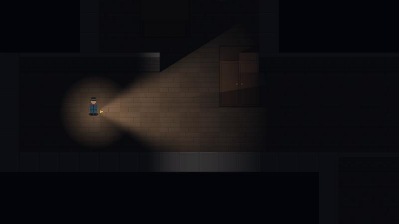
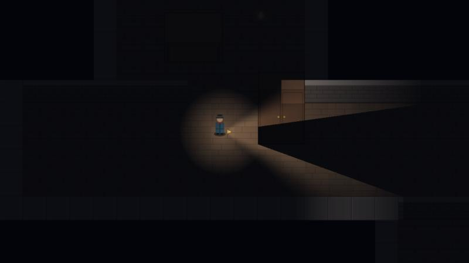
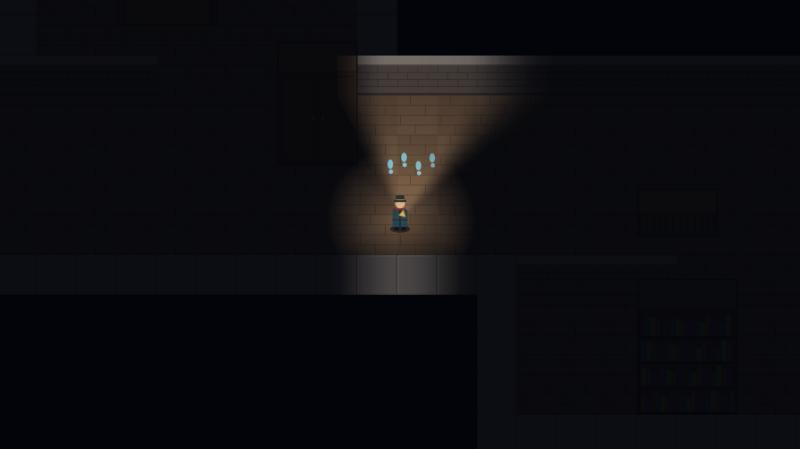
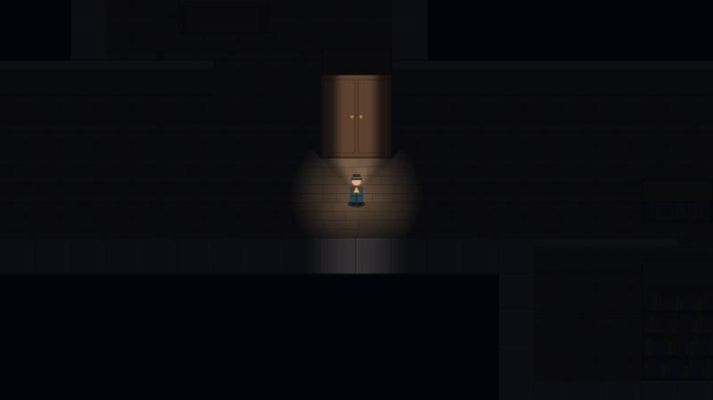
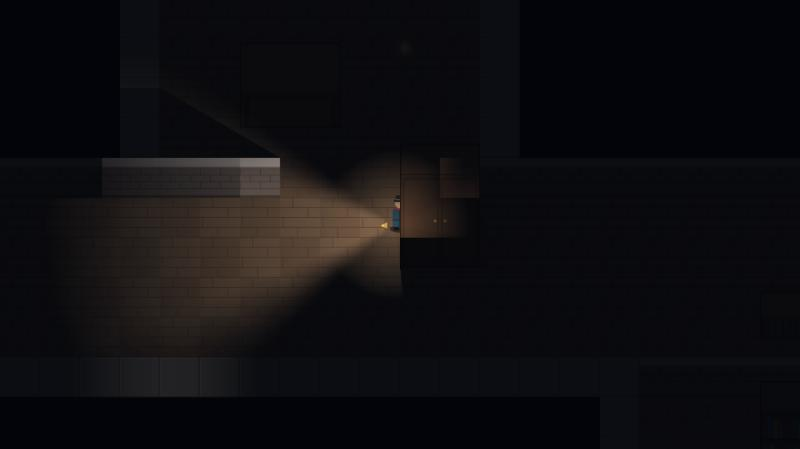
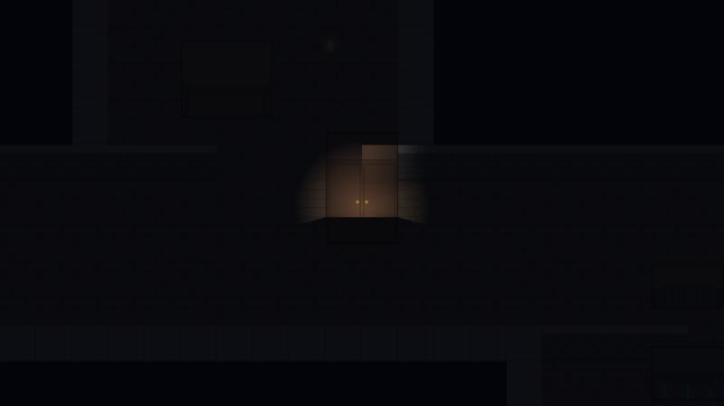
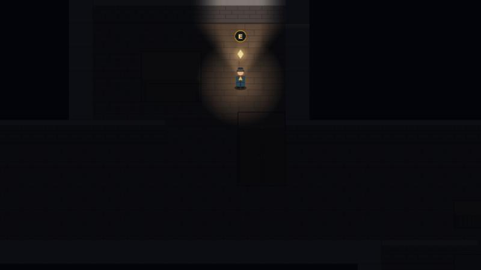
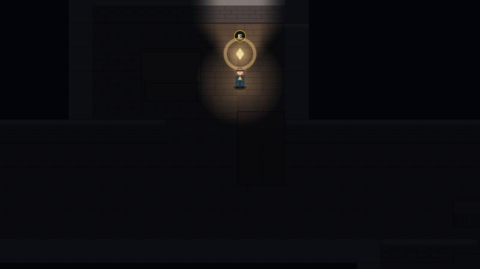
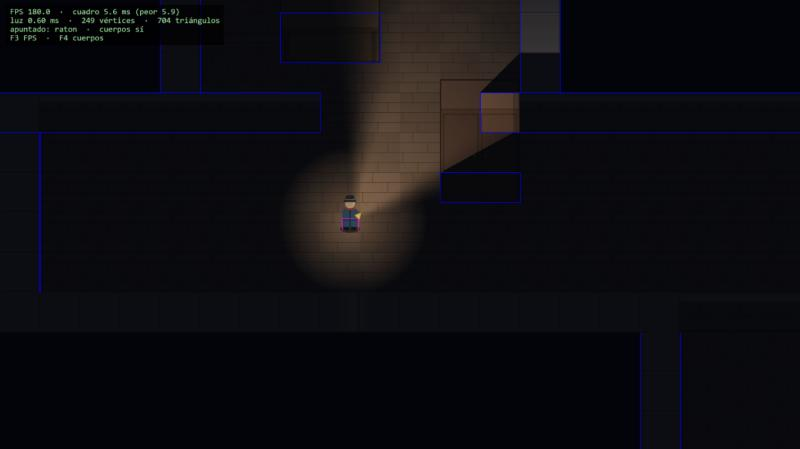

# Informe de la fase 1: prototipo del pasillo

Proyecto: **Inspector Lógica: El Misterio de la Mansión** · v2 (exploración 2.5D) · rama `v2-investigacion`

**Estado:** el prototipo del pasillo funciona. Pasan las 99 pruebas, la lista de la fase 1 queda completa y la consola no mostró errores. El nivel 1 del menú abre el prototipo y los demás niveles muestran "En construcción".

**Commit:** no se hizo. El campo de autorización del paso 0 llegó vacío, así que las fases 0 y 1 (y `DISENO_V2.md`) siguen sin commitear.

---

## 1. Paso 1: arreglos chicos

- **Clave de `Progreso`:** ahora es `inspector-logica-v2-completados`. Se agregaron 6 pruebas con un `localStorage` falso; una comprueba que el progreso de la v1.1 no desbloquea nada.
- **Sprites del Sokoban:** `grep` confirmó que nada los usaba y se borraron `caja.png`, `endPoint.png`, `paredDeRoca.png`, `sueloHierba.png` y `personaje.png`. Se conservan `images.png`, `fondoMenuPrincipal.png`, `fondoNiveles.png` y las capturas.

---

## 2. Lista de la fase 1

| | Punto | Cómo se comprobó |
|---|---|---|
| ✔ | Movimiento en 8 direcciones, diagonal igual de rápida | Con teclas mantenidas: 230 px/s en recta y 230 en diagonal (162,6 por eje). Arranca a ~96 % en 250 ms y frena en ~200 ms. Prueba aparte de que los 8 vectores miden 1. |
| ✔ | Colisiones sin trabarse | Frena exacto en las paredes (x = 77, y = 402,2). Rodea la esquina del armario, se desliza por la pared sur a 163 px/s sin vibrar, y atraviesa en diagonal el hueco de la puerta norte y el de la sur. Contra la esquina sureste, 0,09 px de temblor. |
| ✔ | Cámara suave y dentro de los bordes | El mapa mide 2048×960. El scroll llega exacto a los extremos (este 768, oeste 0, norte 0, sur 240) y nunca sale del mapa. Ante un salto de 500 px llega al 90 % en 339 ms, sin rebotes ni pasarse. |
| ✔ | Profundidad delante y detrás de los muebles | La profundidad es la base de cada objeto: inspector 580 delante del armario (496) y 432 detrás. Capturas 04, 05 y 06. |
| ✔ | Oscuridad, cono suave y luz bloqueada | Cono con borde y caída suaves; el polígono de visibilidad corta la luz con paredes y muebles altos. Capturas 01 y 02. |
| ✔ | Linterna con ratón y con teclado | Con ratón apunta al cursor (−79,6° medido; esperado −79,7°). Con el ratón quieto y caminando, tras 0,8 s apunta a 0° (derecha), −90° (arriba) o 180° (izquierda), y al parar conserva la dirección. |
| ✔ | Revelable que solo aparece con luz | Desde el oeste, el armario lo tapa y no aparece (`alfa` 0). Desde el sur sí (`alfa` 1, captura 03), y desaparece al apartar la luz. |
| ✔ | Interacción con ícono y acción | Lejos no pasa nada y la pulsación no se guarda para después. Cerca aparece el ícono E; pulsar E dispara una sola acción con un anillo que se expande y un latido del objeto (capturas 07 y 08). Esc vuelve al menú y el prototipo se reabre sin duplicar objetos. |
| ✔ | 60 FPS en escritorio | Ver la sección 3. |
| ✔ (emulación) | Medir en celular | Es una emulación: la CPU y la GPU son las mismas del escritorio. No demuestra el rendimiento de un teléfono real. |

Además, **F3** muestra el contador de FPS y **F4** los cuerpos de la física (captura 09).

---

## 3. FPS medidos

| Medición | Resultado |
|---|---|
| Escritorio (GTX 1660 SUPER, ventana de 1280×720), 8 s caminando y barriendo la linterna | 1.440 cuadros, **180 FPS de media** (límite del panel), p95 6,2 ms, p99 6,7 ms, peor cuadro 8,8 ms, ningún cuadro de más de 20 ms |
| CPU por cuadro (lógica + envío de dibujo) | media 1,18 ms · p95 2,3 ms · p99 2,8 ms · peor 3,9 ms (≈ 6 veces de margen sobre 16,7 ms) |
| Celular **emulado** (740×360 horizontal, agente móvil, 5 puntos táctiles; canvas de 640×360 con bandas) | 180 FPS, p99 8 ms, peor cuadro 9,4 ms |

> **Una medida inicial dio ~2 FPS.** Fue una pausa transitoria del panel del navegador: `requestAnimationFrame` puro marcaba lo mismo, la luz solo cuesta 0,7 ms y no volvió a ocurrir. Se anota por honestidad.

---

## 4. Capturas

Tamaño original 1280×720, mostradas a 800 px de ancho. Los archivos están en la carpeta `capturas/`.

### 01 · A oscuridad con el cono de la linterna

### 02 · Luz cortada por un mueble
Desde el oeste, el cono choca con el armario y proyecta una sombra con borde recto hacia el este. Las huellas, que están justo detrás, no existen para el jugador.

### 03 · Revelable iluminado
Alumbrando desde el sur, las huellas aparecen.

### 04 · Profundidad: delante del armario
La cara frontal del armario se ilumina entera (puertas y tiradores).

### 05 · Profundidad: medio cuerpo tapado
Pasando por el borde, el armario tapa la mitad del inspector.

### 06 · Profundidad: detrás del armario
El inspector queda oculto por completo.

### 07 · Interacción: ícono de la tecla E

### 08 · Interacción: respuesta visual al pulsar E
Un anillo que se expande y el objeto que late; sin texto.

### 09 · Depuración: F3 (FPS) y F4 (cuerpos de la física)
Los rectángulos azules son las paredes (unidas), las huellas de los muebles y la base del inspector.

---

## 5. Pruebas: 99 de 99 (tres pasadas seguidas)

| Archivo | Pruebas | |
|---|---:|---|
| `visibilidad.test.mjs` | 16 | nueva |
| `mapa.test.mjs` | 17 | nueva |
| `movimiento.test.mjs` | 13 | nueva (movimiento, cámara y apuntado) |
| `progreso.test.mjs` | 6 | nueva |
| `narrativa.test.mjs` | 17 | |
| `temporizadores.test.mjs` | 16 | |
| `guion.test.mjs` | 6 | |
| `marcas.test.mjs` | 8 | |

Las pruebas del mapa verifican `nivel1.json`: coherencia con el formato de Tiled, que todo es alcanzable y que nada del suelo queda tapado por el dibujo de un mueble.

---

## 6. Qué se construyó

- **Motor sin Phaser** (`src/motor/`, comprobado con `grep`): `Geometria`, `Visibilidad` (polígono y cono), `Movimiento`, `Apuntado` y `Mapa`. Las paredes se unen en rectángulos grandes para que el inspector no se enganche.
- **Presentación:** `Inspector`, `Linterna`, `ArteProvisional`, `IndicadorDeAccion` y `Depuracion`, más la escena `Habitacion` y la provisional `EnConstruccion`.
- **Mapa** `assets/mapas/nivel1.json` en formato JSON de Tiled: inicio, 4 muebles (2 altos que cortan la luz), un revelable y un interactuable.
- **Sin cambios** en: `Narrador`, `Entradas`, `tiemposDeLectura`, `Registro`, `PanelInvestigacion`, `DialogoPrincipal` (con la corrección de temporizadores) ni en la presentación y las capturas del Sokoban.

---

## 7. Bugs encontrados y corregidos durante la fase

- **Cámara corta del objetivo:** quedaba 13 px corta porque redondeaba el desplazamiento en cada cuadro y, a 180 FPS, el paso del suavizado era menor que medio píxel. Ahora guarda decimales y redondea solo al aplicar.
- **Interactuable tapado por la mesa:** estaba bajo el dibujo alto de la mesa. Se movió y se agregó una prueba que lo habría detectado.

---

## 8. Lo que no está, o no se verificó

1. **No se abrió el mapa en Tiled.** No está instalado. Sigue el formato JSON de Tiled, pero no está probado dentro del programa.
2. **`provisional.png`:** es un PNG de 570 bytes que solo existe para que Tiled muestre baldosas. El juego no lo carga; dibuja las suyas por código.
3. **Limitaciones de la luz:**
   - Las sombras tienen borde duro; solo el cono es suave.
   - Desde detrás de un mueble alto, el halo todavía ilumina parte de su cara.
   - Las caras laterales de los muebles no se iluminan.
   - Faltan la luz con mapas de normales (sección 7.2 del diseño) y el polvo en el haz (fase 2).
   - Requiere WebGL; el modo Canvas no se probó.
4. **Cómo se pulsaron las teclas:** las teclas mantenidas se generaron con eventos sintéticos del navegador. Los clics del menú fueron reales, y el ratón fue real (`hover`) en unas pruebas y sintético en otras.
5. **Pendientes:**
   - `README.md` sigue describiendo la v1.1; lo reescribe la fase 7.
   - `Registro.js` guarda con una clave sin versión (`inspector-logica-expediente`) y arrastraría las pistas de la v1.1. Se propone cambiarla en la fase 3, como se hizo con `Progreso`.

---

## 9. Archivos de esta carpeta

- `INFORME_FASE_1.md`: este informe.
- `capturas/`: las 9 capturas.
- `generar_mapa_nivel1_referencia.py`: el script de una sola vez que generó `nivel1.json` y `provisional.png`. Es solo de referencia; el mapa se seguirá editando a mano o en Tiled.

El código está en `C:\Users\dopar\Music\Git\ramon-donoban-jueg-gr3` (rama `v2-investigacion`, sin commit).

Se espera la revisión antes de pasar a la fase 2.
