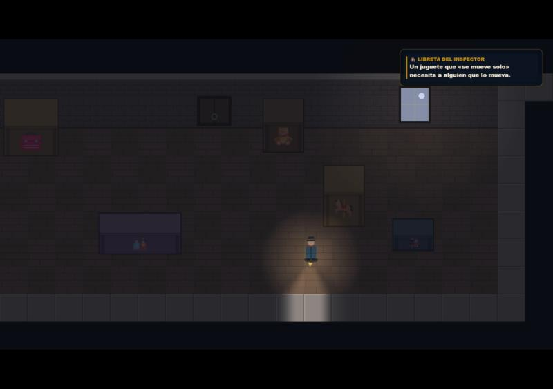
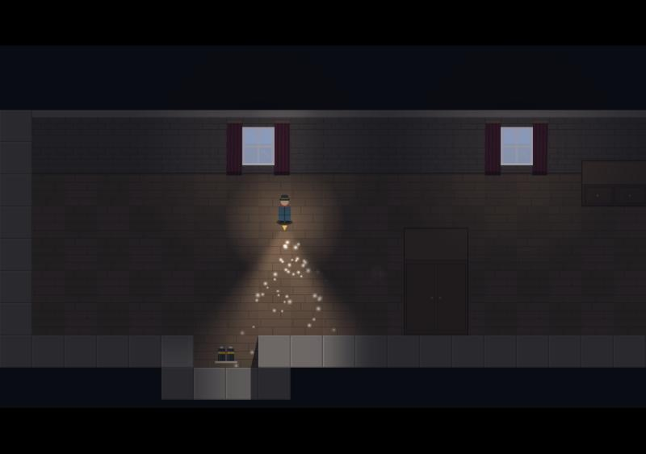

# Informe de la fase 4 — La presentación (parte visual)

Fecha: 2026-11-27 · rama `v2-investigacion` · **sin commit** (el «Autorizado» del PASO 0 llegó en blanco).

**Sin audio, por decisión del autor**: no hay música, efectos, manifiesto, Web Audio ni ajustes de volumen. Anotado en `DISENO_V2.md`, sección 10.
Ningún texto narrativo nuevo. El Narrador, `PanelInvestigacion` y los tiempos de lectura no cambiaron.

## 1. Caja de novela visual
- Reemplaza el dibujo de `DialogoPrincipal` para intro, revelaciones, cierre y error (y la pista importante de los planos). **La máquina de escribir, sus
  temporizadores por identidad, las páginas y el avance son los mismos de antes**: solo cambió cómo se dibuja.
- El juego se oscurece detrás con una viñeta; caja grande semitransparente abajo, placa «INSPECTOR LÓGICA», retrato a un lado que entra con un fundido de
  220 ms y flecha ▼ animada cuando se puede continuar. El título propio (los planos) va dentro de la caja.
- El retrato va a la izquierda; si ahí están las tarjetas, pasa a la derecha (`src/motor/Novela.js`).
- Las líneas secundarias siguen en la caja pequeña, sin pausa.
- Diseño propio: no se copió nada de ninguna obra.

## 2. Retrato
- Dibujado por código en 360 × 480, por capas: cuerpo, cabeza, ojos y cejas, boca, sombrero (`src/presentacion/Retrato.js`). Es **provisional**.
- Arte final: poner `assets/retratos/inspector/<expresion>.png` **y correr `node herramientas/listar_retratos.mjs`**. Ojo: no basta con dejar el archivo.
  La lista hace falta porque pedir un archivo que no existe deja un error 404 en la consola. Una prueba falla si hay un PNG sin anotar.
  Probado en el navegador con un PNG temporal (se usó; luego se borró). Tamaños y capas: `assets/retratos/inspector/README.md`.

## 3. Tabla de expresiones por línea — **para tu aprobación**
Está en `assets/presentacion/expresiones.json` (un dato, sin texto): se cambia ahí sin tocar código.

| Nivel | Línea | Texto (de la narrativa) | Expresión propuesta |
|---|---|---|---|
| 1 | intro | Primera regla del método: todo deja rastro. Segunda regla: los fantasmas no exist… | **serio** |
| 1 | revelación 1ª | Las marcas del suelo coinciden: alguien sacó estas cajas de aquí a propósito. | **pensativo** |
| 1 | revelación 2ª | Detrás de las cajas está la ventana rota; por ahí entra el viento que mueve las c… | **sorprendido** |
| 1 | cierre | Listo. Las cortinas no «caminan»: es la corriente de la ventana rota. El pasillo … | **satisfecho** |
| 1 | error | No, eso no encaja. Corregir un error también es parte del método. | **sonrisa irónica** |
| 2 | intro | Ruidos metálicos en la cocina. Los fantasmas no suelen necesitar sartenes. | **sonrisa irónica** |
| 2 | revelación 1ª | Detrás había una cuerda que sube hasta el techo. Primer hilo del «fantasma». | **pensativo** |
| 2 | revelación 2ª | Un fuelle escondido. Con esto las velas se apagan «solas» desde la otra habitación. | **sorprendido** |
| 2 | cierre | Ahí está el mecanismo completo: poleas, cuerda y fuelle. Y dos tazas en el fregad… | **serio** |
| 2 | error | Mmm, no. Esa pieza no encaja. | **pensativo** |
| 3 | intro | Un candado nuevo en una puerta vieja. ¿Quién cierra con llave una casa abandonada? | **pensativo** |
| 3 | revelación 1ª | El polvo de esta zona está intacto, pero el del camino no. Alguien pasa por aquí … | **serio** |
| 3 | revelación 2ª | Bajo la caja hay huellas recientes. Botas de hombre, talla grande. | **sorprendido** |
| 3 | cierre | Paso despejado. Las huellas siguen hasta el cuarto de los niños... y nadie entra … | **serio** |
| 3 | error | Me adelanté. Volvamos a pensarlo. | **pensativo** |
| 4 | intro | El cuarto de los niños. Los juguetes me miran... o eso quieren que crea. | **serio** |
| 4 | revelación 1ª | Primer juguete desconectado. El hilo sube hasta una trampilla del techo. | **sorprendido** |
| 4 | revelación 2ª | Desde esa trampilla se maneja todo el cuarto, como un teatro de marionetas. | **pensativo** |
| 4 | cierre | Último hilo cortado. Los juguetes no cobraban vida: alguien los manejaba desde ar… | **sorprendido** |
| 4 | error | No. Desenredemos esto con calma. | **neutral** |
| 5 | intro | Una silueta cruzó la ventana. Esta vez no voy a dejar que escape. | **serio** |
| 5 | revelación 1ª | Salida al jardín bloqueada. La sombra ya no puede huir por aquí. | **satisfecho** |
| 5 | revelación 2ª | La chimenea, apagada a tiempo. Parte de los papeles se salvó. | **neutral** |
| 5 | pista de los planos | El despacho está marcado en rojo, con una nota: «bajo el reloj». | **pensativo** |
| 5 | cierre | ¡Atrapado! La sombra era un cómplice, empapado y con las manos manchadas de hollí… | **satisfecho** |
| 5 | error | Calma. Si me precipito, se escapa. | **serio** |
| 6 | intro | El despacho del viejo Flieder. Aquí termina la mentira. | **serio** |
| 6 | revelación 1ª | Archivos en orden. Las cuentas de la herencia no cuadran desde hace años. | **pensativo** |
| 6 | revelación 2ª | Siete ofertas de compra, siete rechazos. Ninguno por fantasmas. | **serio** |
| 6 | cierre | Y la última pieza: bajo el reloj detenido, el escondite del tesoro... vacío, con … | **sorprendido** |
| 6 | error | No. A estas alturas, cada detalle importa. | **serio** |

## 4. Efecto del cierre
- Al cerrar, el fenómeno se apaga y la oscuridad se aclara en 2,8 s hasta ver la habitación (`src/motor/Luz.js`). Para que se vea, durante el cierre lo de
  detrás de la caja casi no se oscurece.
- **Nivel 6:** la cámara va hacia el reloj y se le pone una luz propia; el compartimento queda a la vista aunque la linterna apunte a otro lado (`10`).
- **Nivel 4:** la cámara va a la ventana y la silueta cruza cuando ya hay luz (`12`).
- **Relámpagos** (solo luz): en las habitaciones con ventana (**niveles 1 y 4**), cada 9–18 s, 0,5 s; no durante textos, libreta ni cierre (`11`).
  El nivel 5, pese a su título, no tiene ventana en el mapa y no tiene relámpagos.
- Dos fallos anteriores corregidos al verificar:
  - **La silueta del nivel 4 nunca se vio**: la ventana se dibujaba por debajo del muro. Mis informes del nivel 4 la daban por hecha sin captura.
  - Durante un texto importante quedaba un marco vacío donde estaba la tarjeta oculta.

## 5. Capturas (`capturas/`)
| Archivo | Qué muestra |
|---|---|
| `01` a `06` | la caja con las seis expresiones (sonrisa irónica, serio, pensativo, sorprendido, satisfecho, neutral) |
| `07` | la caja en carga extrema (7 páginas) |
| `08`, `09` | el cierre con la luz (pasillo) y entrando, con la caja (la sombra) |
| `10` | el compartimento del nivel 6 a la vista |
| `11` | un relámpago |
| `12` | la silueta frente a la ventana |

Las capturas 01–06 se prepararon poniendo cada línea real en su habitación; en la campaña salieron solas con las mismas expresiones.

## 6. Verificación
- **Pruebas: 498, 0 fallos.** Nuevas: `cajaGrande.test.mjs`, `expresiones.test.mjs`, `luz.test.mjs` (el cierre del nivel 6 con el código real de la
  escena: la luz sube y el compartimento queda en pantalla sin que la caja ni el retrato lo tapen). Las de temporizadores siguen en verde.
- **Campaña 1 → 6 → créditos** en una pestaña nueva y sin datos guardados, jugada por el **jugador automático** (camina sin teletransporte; no es una
  persona). Salieron **30 líneas importantes, todas con su caja, retrato y la expresión de la tabla**; la 31ª (el error del nivel 5, porque no se falló
  ningún intento) se provocó aparte y también coincide.
- **FPS reales:** 181 al entrar en cada uno de los seis niveles, página visible. **Consola sin errores.**
- Los niveles 1 y 5 esperaron a que se leyera una tarjeta pendiente antes del informe (arreglo 6.1).

## 7. Maquetación
Revisor F6, 35 pantallas, contenido real máximo y `?carga=extrema`:

| Pantallas | Elementos revisados (real / extrema) | Solapes, fuera de recuadro o recortados |
|---|---|---|
| caja grande con retrato | 7 / 7 (7 páginas en extrema) | 0 / 0 |
| caja grande con tarjetas | 13 / 7 | 0 / 0 |
| tarjetas | 12 / 6 | 0 / 0 |
| espera antes del informe | 6 / 6 | 0 / 0 |
| las otras 31 | — | 0 / 0 |
| **Total: 35** | | **0 / 0** |

El recorrido completo se hizo antes de las dos últimas correcciones (marco vacío y ventana); después se repitieron las 4 pantallas afectadas.

## 8. Lo no verificado y observaciones
- Una partida con una **persona**: si el retrato y el ritmo se sienten bien, si el oscurecido es demasiado (la habitación detrás de la caja se ve casi
  negra salvo en el cierre) y si el relámpago molesta. El relámpago aclara bastante: deja ver un instante dónde está cada cosa.
- Pantallas de otra proporción y celular (fase 7).
- La carpeta `assets/audio/` sigue ahí, vacía; no la borré.
- El retrato es provisional y tosco comparado con un arte final.

---

# Arreglo 4.1 (2026-11-27)

Sin commit: el «Autorizado» del PASO 0 llegó en blanco. La fase 4 y la tabla de expresiones quedaron **aprobadas**.

## 4.1.1 El relámpago ya no enseña lo que solo se ve con la linterna
- **Regla general:** lo dibujado que solo debe verse donde toca la linterna se registra en la habitación (`registrarSoloConLuz`) y, durante el destello,
  se **recorta a la forma de la linterna** (cono, tapado por muebles y paredes, y el halo del inspector). Al acabar el destello se quita el recorte.
- Registrado: todos los revelables (marcas, polvo, camino limpio, pisadas mojadas, mancha de aceite, marcas de los archivos…), los **hilos** del cuarto de
  juguetes, el vapor de la cocina, el candado, las tablas huecas, la sombra y **los objetos que se pueden recoger** (pistas y pilas). Esto último no lo
  pediste, pero eran lo que más delataba el destello.
- Muebles, puertas, cortinas y ventanas sí se ven un instante: es el ambiente.
- Los revelables ya tenían alfa 0 fuera del cono; lo que se veía eran los hilos y los objetos, que solo dependían de la oscuridad.
- Hoy solo hay ventanas (y relámpagos) en los niveles 1 y 4; la regla vale para cualquier habitación que las tenga después.

## 4.1.2 Un destello más suave
- La oscuridad (0,94) baja como mucho a **0,55** junto a una ventana (en un círculo de 250 px) y a **0,78** lejos de ellas (`src/motor/Luz.js`).
  Interpreté «hasta un 55 %» como que la oscuridad se queda en 0,55.
- El tinte azulado pasó de 0,2 a 0,05 y el vidrio sigue brillando.

## 4.1.3 README y audio
- `README.md` reescrito para la v2 (historia, controles, las seis habitaciones sin soluciones, cómo ejecutarlo en local y en GitHub Pages, pruebas,
  estructura, arte provisional y reemplazo del retrato, sin audio, autor).
- Borrada `assets/audio/` (solo tenía dos `.gitkeep`) y quitadas sus referencias del diseño. Los informes antiguos de `docs/` siguen mencionando audio
  como historia.
- No publiqué nada: **GitHub Pages seguirá mostrando la versión 1** hasta que la v2 se commitee, se suba y se publique.

## 4.1.4 Verificación
- **Pruebas: 501, 0 fallos.** Nuevas: con el destello al máximo un revelable fuera del cono sigue con alfa 0; el recorte deja ver lo de delante y no lo de
  detrás ni lo de los lados, y se quita después; la oscuridad nunca baja de 0,55.
- **En el navegador** (181 FPS, página visible), con la linterna apuntando al sur:
  - juguetes: los hilos, la bobina, el diario y las pilas no se ven (`13`);
  - pasillo: las marcas y la huella no se ven; las pilas sí, porque estaban dentro del cono (`14`);
  - tras varios relámpagos seguidos no queda ningún recorte puesto. **Consola sin errores.**
- La interfaz no cambió: no repetí el recorrido de maquetación.

La captura `11` es la anterior, y queda como referencia de cómo se veía.

## 4.1.5 No verificado
- Que una persona considere el destello suficiente como ambiente (ahora es bastante discreto).
- No volví a jugar la campaña completa tras este arreglo.

